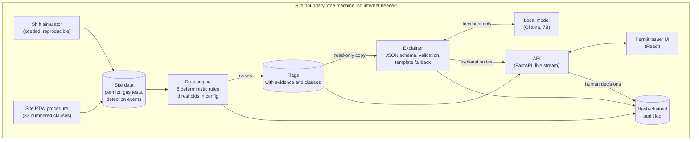
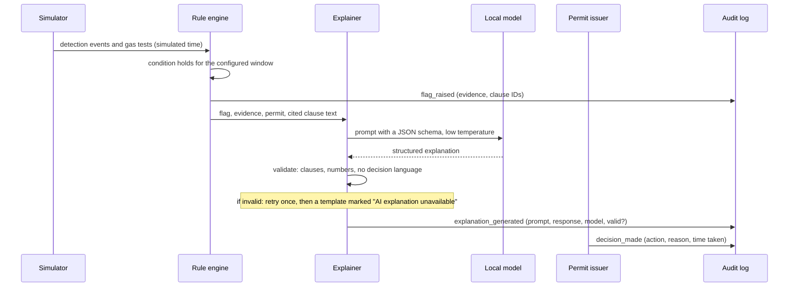

# Permit Guardian: project overview

**A working prototype of the human side of on-premises safety AI: the AI flags, people
decide, and every step leaves a record.**

## In one paragraph

In a refinery, dangerous jobs such as welding, entering a tank or lifting with a crane
need a permit to work. The permit sets strict conditions: where the work may happen,
for how long, and with which controls, such as a recent gas test or a dedicated fire
watch. Accidents often start when the real work drifts away from its permit.
Permit Guardian watches a simulated shift at a fictional site (Northbank Refinery,
Unit 3) and flags possible permit breaches for a human permit issuer to review.

Simple, predictable rules decide what gets flagged. A small language model running on
the same machine only explains each flag in plain words and points to the procedure
clause it relates to. The model can never raise, dismiss or change a flag, and the app
keeps working if the model fails. Every flag, explanation and human decision goes into
a tamper-evident audit log. Workers are anonymous codes, never faces, and no data
leaves the machine.

The simulated shift contains both real violations and deliberately misleading false
alarms. That lets the project measure how accurate the rules are, and run a user study
on the question that matters most for safety AI in the field: do AI explanations help
people catch the AI's mistakes, or do they make people trust it too much?

## The problem

Camera-based AI can spot permit drift. Typical cases:

- a job moving outside its permitted area
- a gas test going stale
- a fire watch walking away
- work continuing after a permit has expired
- a crane lift swinging over an active hot-work area

Detection is only half of the problem. A stream of AI alerts creates its own hazards.
If people accept alerts without checking, a false alarm stops work for no reason. If
they learn to ignore alerts, a real one gets missed. What decides whether the system
is safe is the interface between the AI and the person who signs the permit: what
evidence they see, how the AI's uncertainty is shown, and how their decision is
recorded.

## What the system does

1. **Simulate a shift.** A seeded generator produces a reproducible 12-hour day shift.
   It contains permits, gas tests, pseudonymous workers and a stream of "camera"
   detection events. Each event records position, activity, PPE and detector
   confidence, never images or identities.
2. **Check the rules.** Eight deterministic rules compare the events with each permit's
   conditions. Examples: "hot work in progress with a gas test older than 120 minutes"
   and "more people inside a confined space than the permit allows". When a rule
   trips, it raises a flag. The flag carries the exact evidence and the procedure
   clauses it relates to.
3. **Explain.** A local language model writes a short, structured explanation of each
   flag: what was seen, why it matters and what to check. The explanation is labelled
   as AI and checked before anyone sees it (see "How the AI is kept in check" below).
4. **Decide.** The permit issuer confirms, dismisses, escalates or asks for a gas
   re-test. A dismissal requires a written reason.
5. **Record.** Every flag, explanation and decision is appended to a hash-chained audit
   log that anyone can verify. At the end of the shift, the system drafts a handover
   brief for the next shift.
6. **Study.** A built-in study mode compares two interface designs on the same flags.
   It measures whether people catch the AI's wrong flags.

## Three principles, enforced in code

| Principle | How the code enforces it | Status |
|---|---|---|
| **Agents flag; people decide** | Only the deterministic rule engine can create a flag. The language model only receives a copy of the flag and returns text; it has no way to write to flags. Only a human decision can change a flag's status, and a dismissal must have a reason. | Rules in M2, decisions in M3 |
| **Sovereign by architecture** | The only network calls go to a local model server (Ollama) on `localhost`. There are no cloud APIs and no telemetry. Frontend fonts and scripts are bundled, never loaded from a CDN, and the API's built-in documentation pages are switched off because they use one. The server listens only on the local machine. A final test makes the app fail if anything contacts another host. | Done in M0; final test in M7 |
| **Every action carries its record** | The audit log is append-only. Each record stores a hash of the record before it, so any edit breaks the chain, and `make verify-audit` checks it. Every model call logs the model name and version, the full prompt, the response, the latency and whether the output passed validation. | M3 and M4 |

Two further rules shape the design:

- **Privacy by design.** Workers appear only as pseudonymous badge codes (W-017) with a
  role. No faces, no names and no biometric data exist anywhere in the data model.
- **Read-only toward the plant.** Process and detection data is input only. No code
  path can act on plant equipment.

## Architecture

Everything runs on one machine inside the site boundary. Nothing needs the internet.

### The life of one flag

### How the AI is kept in check

The language model's output is validated before anyone sees it:

- **Citations.** It may only cite clauses it was given, and must cite at least one.
- **Numbers.** Every number or time in its text must appear in the evidence, so it
  cannot invent a reading.
- **No decisions.** Text that tells the person what to decide, such as "this is safe",
  is rejected.
- **Fallback.** If validation fails twice, the person sees a plain template instead,
  clearly marked "AI explanation unavailable".
- **Caching.** Explanations are cached per flag, model and prompt version. Every study
  participant sees exactly the same text.

### Components

| Component | What it does | Technology | Status |
|---|---|---|---|
| Shift simulator | Generates a reproducible shift with planted real violations and decoys, and keeps the true answers separate | Python | **Built** |
| Procedure | Original mock permit-to-work procedure, parsed into a clause table at startup | Markdown parser | **Built** |
| Health check | `make doctor` checks Python, Node, the local model server and the model | Python standard library | **Built** |
| Rule engine | 8 rules, debounce windows in `config/rules.yaml`, replay at configurable speed | Python, pure functions | Next (M2) |
| API and audit log | REST endpoints, live flag stream, hash-chained log, `make verify-audit` | FastAPI, SQLite | M3 |
| Explainer | Flag explanations and shift handover brief, validated, cached, logged | Ollama, structured output | M4 |
| Issuer UI | Flag queue, schematic site plan with timeline, clause and AI panels, keyboard actions | React, TypeScript, Tailwind | M5 |
| Study mode | Two conditions, questionnaires, per-trial logging, CSV export, analysis notebook | React, pandas, statsmodels | M6 |

## The research question

> Does showing evidence, clause citations and an AI explanation help permit issuers
> catch the AI's wrong flags, without slowing them down too much, compared with a
> minimal alert?

- **Two interface conditions:**
  - *Minimal*: rule, permit, severity and confidence only.
  - *Explained*: the full evidence, the clause text and the AI explanation.
- **Trials:** about 40 flags per participant, about 15% of them decoys (flags the
  system raised wrongly).
- **Design:** every participant uses both conditions, with the order counterbalanced
  and matched flag sets, so no one sees the same flag twice.
- **Measures:**
  - accuracy
  - over-reliance (confirming a wrong flag)
  - under-reliance (dismissing a real one)
  - decision time
  - which evidence people actually looked at
  - trust in automation (Jian et al., 2000)
  - workload (NASA-TLX)
- **Analysis:** a mixed-effects model with participant as a random effect.

This matters beyond the prototype. Over-reliance on an alerting system is a safety
hazard in its own right. A study like this produces evidence for product decisions
that are otherwise argued from intuition: how much to show, where to show uncertainty,
and when an explanation helps.

## What is built today

Two of eight milestones are done, with 60 automated tests passing:

- **One reproducible shift.**
  - 8 areas, 28 permits across five permit types, 28 pseudonymous workers
  - 34 gas tests, 6 lift plans and 7,822 detection events
  - The same seed gives identical output every time.
- **45 planted scenarios:** 32 real violations and 13 decoys.
  - Examples of decoys: a worker 0.5 m outside the work area for 2 seconds; a valid gas
    re-test whose record arrives late; a fire watch briefly hidden from the camera;
    a wire brush the detector misreads as grinding.
  - The tests confirm every scenario directly from the raw events. The data contains
    no unplanned violations.
- **The true answers are stored separately** from everything the rules can read, so
  accuracy can be measured honestly.
- **A 33-clause site procedure**, written from scratch in the style of UK
  permit-to-work practice.
- **One-command setup:** `make doctor`, `make setup`, `make seed`, `make test` and
  `make dev`.

## Roadmap

| Milestone | Scope | Status |
|---|---|---|
| M0 Scaffold | Repo, tooling, `make doctor` | Done |
| M1 Data | Domain model, shift simulator, scenarios with ground truth, procedure | Done |
| M2 Rules | 8 rules, simulated-time replay, per-rule precision, recall and confusion matrix | Next |
| M3 API and audit | Endpoints, live stream, hash-chained audit log, `make verify-audit` | Planned |
| M4 Language model | Explanations and handover brief, validation, fallback, caching, logging | Planned |
| M5 Interface | Flag queue, site plan, timeline, handover and audit screens, WCAG AA | Planned |
| M6 Study mode | Conditions, sessions, questionnaires, export, pilot data, analysis | Planned |
| M7 Polish | Plain-language README, demo script, network-guard test | Planned |

The full build specification is in [spec.md](spec.md). Each design choice made along
the way is recorded with its reason in [DECISIONS.md](../DECISIONS.md).

## From prototype to deployment

The parts are separated so that each simulated piece can be replaced by a real one:

- **Detection feed.** A real edge-vision feed would replace the simulator through the
  same detection-event interface. It would carry the same fields: position, activity,
  PPE and confidence.
- **Model server.** The model server can move to an on-premises GPU server inside the
  site boundary by changing one setting.
- **Procedure.** A site's own procedure would replace the mock one. The rules already
  cite clauses by ID.
- **Production hardening.** SQLite would give way to a server database, and
  authentication and role-based access would be added.

## Scope and limits

- **Not a safety system.** This is a research and design prototype, not a certified
  safety system.
- **Simulated data.** The site, the procedure, the workers and every reading are
  fictional. The procedure's limits are invented for the fictional site and are not
  regulatory values.
- **No real detector.** The detector is simulated, so its error patterns are the ones
  the scenarios were designed to have. Real detectors will fail in other ways.
- **Pilot data only, for now.** The study mode will be tested with generated pilot data.
  Running it with real participants requires ethics approval first.
